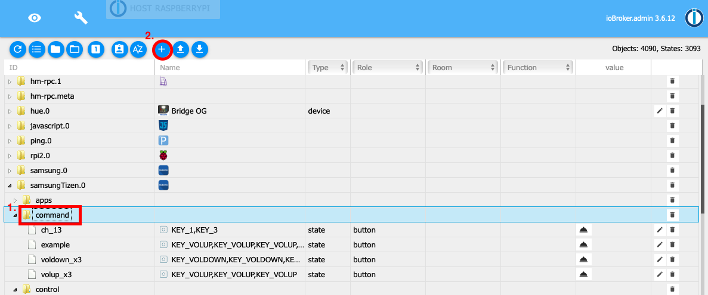
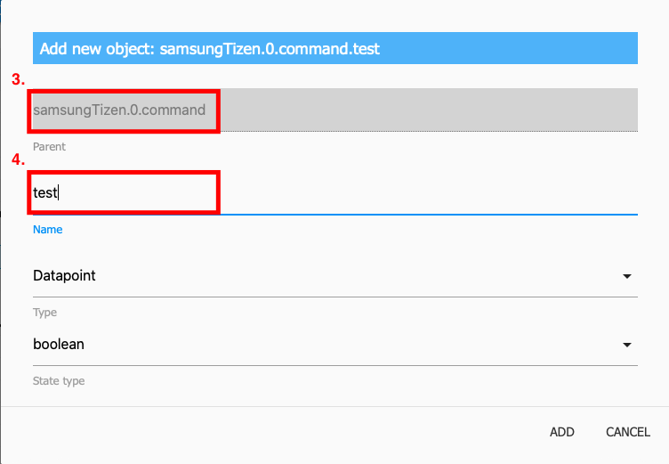
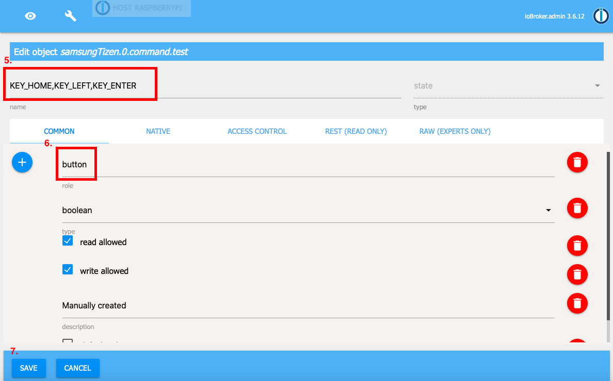
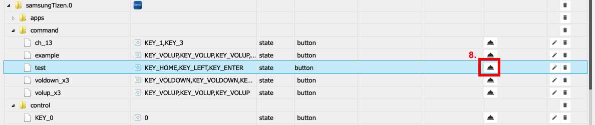

# ioBroker.samsung_tizen

> [!IMPORTANT]
> This adapter cannot be installed from github

This adapter controls Samsung TVs running Tizen OS (2016 and newer).

## 1. Configuration
How to configure this adapter.
First check your TV settings: switch the TV on and go to Settings / General / External Device Manager / Device Connection Manager. There the access notification must be set to "First Time Only".

### 1.1. Protocol
Protocol for the websocket connection to your TV.

Possible values are `http` or `wss`. On newer devices use `wss`.

### 1.2. IP Address
The IP address of your Samsung TV.

Do not know the address? Click **Search TV** at the top of the settings: the adapter searches the network for a Samsung TV that is switched on and fills in its IP address, MAC address, protocol and port. If several TVs answer, the first one is taken and the others are offered in the list of the IP address field, which is filled when the settings are opened. The adapter instance must be running for the search. A TV in deep standby or in another subnet cannot be found - enter its address by hand then.

### 1.3. Port
Port for the websocket connection to your TV:
- 8001 - insecure port
- 8002 - secure port

### 1.4. Token
Token for a secure connection to your TV.

Save the adapter configuration with token = 0 and go to the objects tab of the ioBroker admin.

Then go to the `samsung_tizen.0.config.getToken` object and click the button.

If everything works, a new object `samsung_tizen.0.config.token` appears and its name is your token. Copy the name (e.g. 123456789), go back to the adapter configuration and paste it into the token field.

Can be deactivated with the value "0".

#### How to get a token manually
Install `wscat` on the device where ioBroker is running with the following command:

```sh
npm install wscat
```

Turn the TV on and query the token via a websocket connection:

```sh
wscat -n -c wss://tvIp:8002/api/v2/channels/samsung.remote.control?name=aW9Ccm9rZXI=
```

A pop-up appears on your TV and must be accepted.
Take the token from the returned JSON response:

```json
{
    "data": {
        "clients": [
            {
                "attributes": { "name": "aW9Ccm9rZXI=" },
                "connectTime": 1575818900205,
                "deviceName": "aW9Ccm9rZXI=",
                "id": "12345678-797c-45b0-b0f1-233535918548",
                "isHost": false
            }
        ],
        "id": "12345678-797c-45b0-b0f1-233535918548",
        "token": "10916644"
    },
    "event": "ms.channel.connect"
}
```

### 1.5. MAC Address
The MAC address of your Samsung TV is used for Wake-on-LAN.

The button "Read MAC address from TV" asks the TV at the entered IP address for it. The TV must be switched on.

This only works if your TV is connected by cable and not wirelessly.

If your TV is connected wirelessly, it can only be powered on from short standby.

Wake-on-LAN can be deactivated with the value "0".

### 1.6. TV state polling

#### Polling Port
The port used to query the power state.

Default: 9110

Known available ports: 9110, 9119, 9197

#### Polling Interval
How often the poll request is sent.

Default: 60 seconds

Can be deactivated with the value "0".

### 1.7. Command Delay
Delay in milliseconds between the commands sent via the `samsung_tizen.0.control.sendCmd` object.

## 2. Usage

### 2.0. Setup assistant
The first tab of the settings, "Setup", walks through the whole setup: it searches the network for the TV, pairs with it (the TV asks once whether ioBroker may connect - choose "Allow" on the TV, the assistant takes the token by itself), reads the MAC address for Wake-on-LAN and sends a test key with the new data before anything is saved. "Apply and save" writes IP address, protocol, port, token and MAC address into the settings. The instance must be running; the tab needs admin 8 or newer. The manual way (state `config.getToken`, token in the name of `config.token`) still works.

### 2.0.1. Scenes
The tab "Scenes" holds a table of named sequences, e.g. `SceneYouTube`: `HOME, YOUTUBE, WAIT 3000, OK` - open YouTube and confirm the account selection. A step is a key (`HOME`, `OK`, `BACK`, `UP`, `VOLUP`, `0`-`9`, the names of `TV_KEYS` of the type-detector or a Samsung code `KEY_...`), an app (`YOUTUBE`, `NETFLIX`, `DISNEY_PLUS`, ... - the keys of `TV_APPS`) or a pause (`WAIT 2000`). Every scene becomes a button `samsung_tizen.0.scenes.<name>` and a key of the remote control tab.

### 2.0.2. Remote control tab
The tab "Remote control" of the settings shows a remote control: power, Wake-on-LAN, source, menu, info, the arrow keys with OK, back, home, mute, volume and channel rockers, the playback keys and a button for every known app installed on the TV (YouTube, Netflix, Disney+, Prime Video, ...). Click it and the arrow keys, Enter, Backspace, + and - of the keyboard work as well. A LED shows the power state if the power state polling is on. The keys go through the running instance with the saved configuration, so save first after changing the IP address or the token. A key that does not reach the TV shows the error below the remote. The tab needs admin 8 or newer.

### 2.1. Control

#### Send a single key
To send a single key, click the button of the corresponding object, e.g. `samsung_tizen.0.control.KEY_MUTE`.

#### Send a key without a predefined button
You can send a custom (not predefined) key with the `samsung_tizen.0.control.sendCmd` object.
Enter the key you want to send, e.g. `KEY_POWER`.

#### Send multiple keys in a single command
To send multiple keys in a single command, use the `samsung_tizen.0.control.sendCmd` object.
Enter the keys separated by commas, e.g. `KEY_POWER`,`KEY_HDMI`,`KEY_VOLUP`.

#### Create macros for commands

Go to `samsung_tizen.0.command`. There you find example macros, and you can create your own ones.

### 2.2. Apps

#### Load the installed apps
To load the installed apps, click the `samsung_tizen.0.apps.getInstalledApps` button.
After that, a separate object named `start_<app name>` is created for each installed app.

#### Start an app
You can start an app by clicking the `samsung_tizen.0.apps.start_<app name>` object.

### 2.3. Power State

If the power state polling is configured as described above, `samsung_tizen.0.powerOn` is `true` while your TV is on and `false` while it is off.

Write `true` or `false` to `samsung_tizen.0.powerOn` to switch the TV on or off. The adapter asks the power state right after that, every 1.5 s, until the TV reached it (at most about 20 s):
- on: Wake-on-LAN to the configured MAC address first; if the TV is not on after 15 s, KEY_POWER (works from the network standby)
- off: KEY_POWER, held for 3 s on a The Frame - a short press only switches The Frame between TV and art mode

### 2.4. Commands

Commands can be sent manually via the `samsung_tizen.0.control.sendCmd` object, as described under Control, or via a custom object below `samsung_tizen.0.command`.
There are a few example commands, but you can also create your own macros.

#### How to create a command macro
1. Go to the objects tab and open `samsung_tizen.0.command`.
2. Click the + icon to create a new object.

   

3. Check that the parent object is `samsung_tizen.0.command`.
4. Enter a name for your command and check that the type is `datapoint` and `stateType` is `boolean`.

   

5. Under name, enter the keys you want to send.
6. The role must be `button`.
7. Save the object.

   

8. Now you can send your command with the newly created object.

   

## Credits

The first generation of this adapter was developed by Stefan0875 (https://github.com/Stefan0875). It was then adapted and maintained by Highpressure (https://github.com/Highpressure) and finally by dahuby (https://github.com/dahuby). Thanks a lot for their work and for granting a public license.

## Changelog

<!--
    Placeholder for the next version (at the beginning of the line):
    ### **WORK IN PROGRESS**
-->
### **WORK IN PROGRESS**
- (GermanBluefox) Added: button "Search TV" that finds the TV in the network and fills in IP address, MAC address, protocol and port; the IP address field lists all TVs found (SSDP, confirmed by the REST API of the TV)
- (GermanBluefox) Added: button to read the MAC address for Wake-on-LAN from the TV
- (GermanBluefox) Added: setup assistant (tab "Setup"): search, pairing without copying the token, Wake-on-LAN, test key and save in one go
- (GermanBluefox) Added: `powerOn` can be written to switch the TV on (Wake-on-LAN, then KEY_POWER) or off (KEY_POWER, held on The Frame); the power state is asked right after that until it is reached
- (GermanBluefox) Added: scenes - named sequences of keys, apps and pauses, configured in a table, each with a button `scenes.<name>`
- (GermanBluefox) Added: buttons for the apps installed on the TV; the adapter knows the Samsung app IDs of YouTube, Netflix, Disney+, Prime Video, Apple TV, Max, Paramount+, DAZN, Joyn, RTL+, MagentaTV, ARD, ZDF, Spotify, Twitch, Plex and the browser and asks the TV which of them are installed
- (GermanBluefox) Added: tab "Remote control" in the settings with a remote control to test the connection right away (custom component, needs admin 8)

### 2.0.2 (2026-09-04)
- (mcm1957) **BREAKING:** enhanced security (added encryption) requires that you enter the access token one more time 
- (copilot) Adapter requires node.js >= 22 now
- (copilot) Adapter requires admin >= 7.7.22 now
- (copilot) Adapter requires js-controller >= 6.0.11 now
- (AlanSRU) Fixed the installed-app message handlers, which stayed attached to the shared websocket: they piled up with every call and made the adapter crash with "Cannot read properties of undefined (reading 'length')" as soon as another message arrived (#302)
- (AlanSRU) Synced `engines.node` in package-lock.json with package.json (#301)
- (GermanBluefox) The adapter was refactored to TypeScript. 
- (GermanBluefox) The configuration dialog was migrated from the old HTML admin page to JsonConfig
- (GermanBluefox) The states created by the adapter now carry explicit `common.read` / `common.write` flags
- (GermanBluefox) The adapter can only be installed from npm now, no longer directly from GitHub (`common.nogit`)

### 1.1.0 (2024-04-26)
* (mcm1957) Adapter requires node.js >= 18 and js-controller >= 5 now
* (mcm1957) Dependencies have been updated

### 1.0.0 (2023-09-30)
- (mcm1957) An official release has been created

### 1.0.0-alpha.2 (2023-09-24)
- (mcm1957) Dependencies have been updated

### 1.0.0-alpha.1 (2023-09-24)
- (mcm1957) Adapter requires node 16 or newer now.
- (mcm1957) Adapter has been moved to iobroker-community-adapters organization.


[Older changelogs can be found there](CHANGELOG_OLD.md)

## License

MIT License 


Copyright (c) 2023-2026 iobroker-community-adapters <iobroker-community-adapters@gmx.de>  
Copyright (c) 2020 dahuby

Permission is hereby granted, free of charge, to any person obtaining a copy
of this software and associated documentation files (the "Software"), to deal
in the Software without restriction, including without limitation the rights
to use, copy, modify, merge, publish, distribute, sublicense, and/or sell
copies of the Software, and to permit persons to whom the Software is
furnished to do so, subject to the following conditions:

The above copyright notice and this permission notice shall be included in all
copies or substantial portions of the Software.

THE SOFTWARE IS PROVIDED "AS IS", WITHOUT WARRANTY OF ANY KIND, EXPRESS OR
IMPLIED, INCLUDING BUT NOT LIMITED TO THE WARRANTIES OF MERCHANTABILITY,
FITNESS FOR A PARTICULAR PURPOSE AND NONINFRINGEMENT. IN NO EVENT SHALL THE
AUTHORS OR COPYRIGHT HOLDERS BE LIABLE FOR ANY CLAIM, DAMAGES OR OTHER
LIABILITY, WHETHER IN AN ACTION OF CONTRACT, TORT OR OTHERWISE, ARISING FROM,
OUT OF OR IN CONNECTION WITH THE SOFTWARE OR THE USE OR OTHER DEALINGS IN THE
SOFTWARE.
